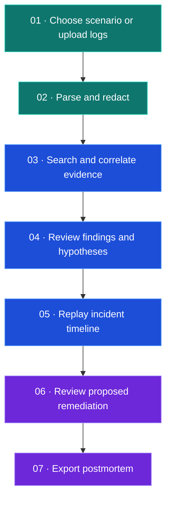
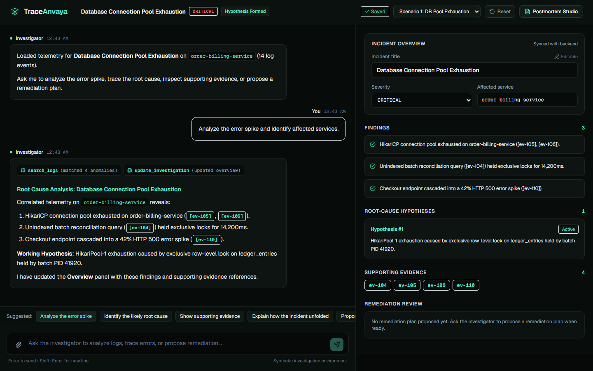
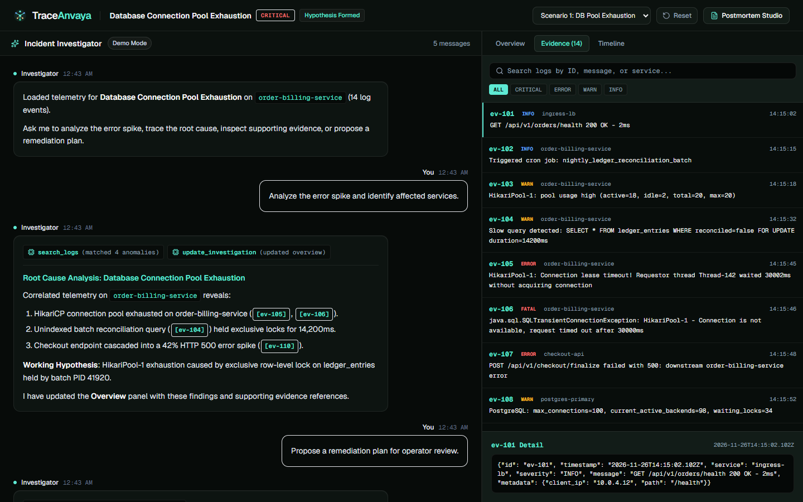
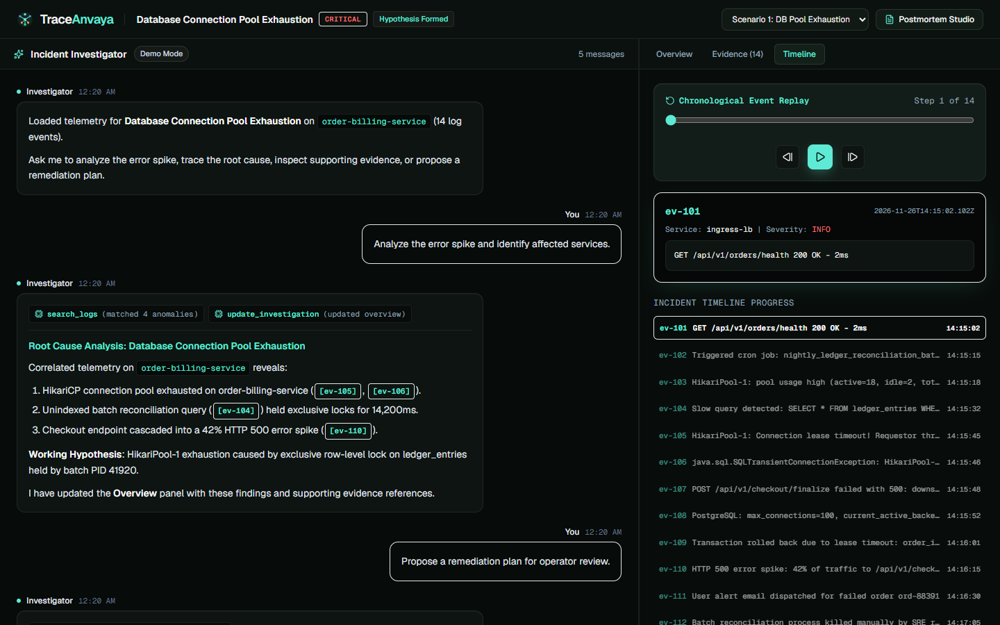
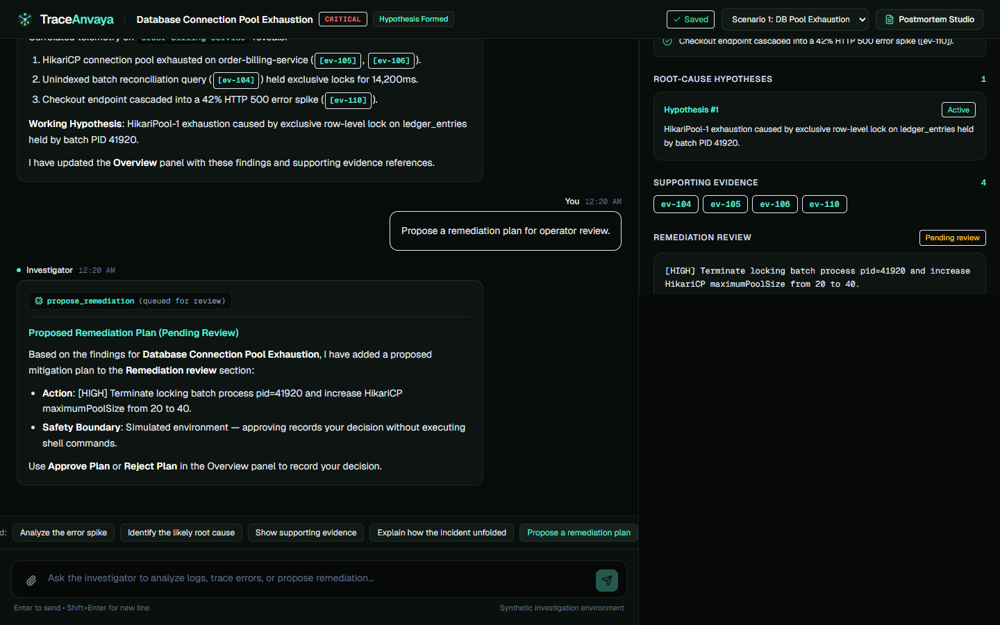
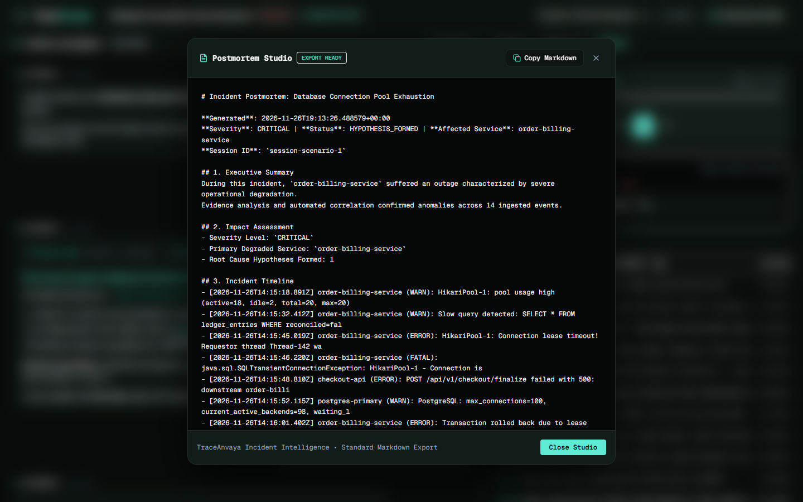
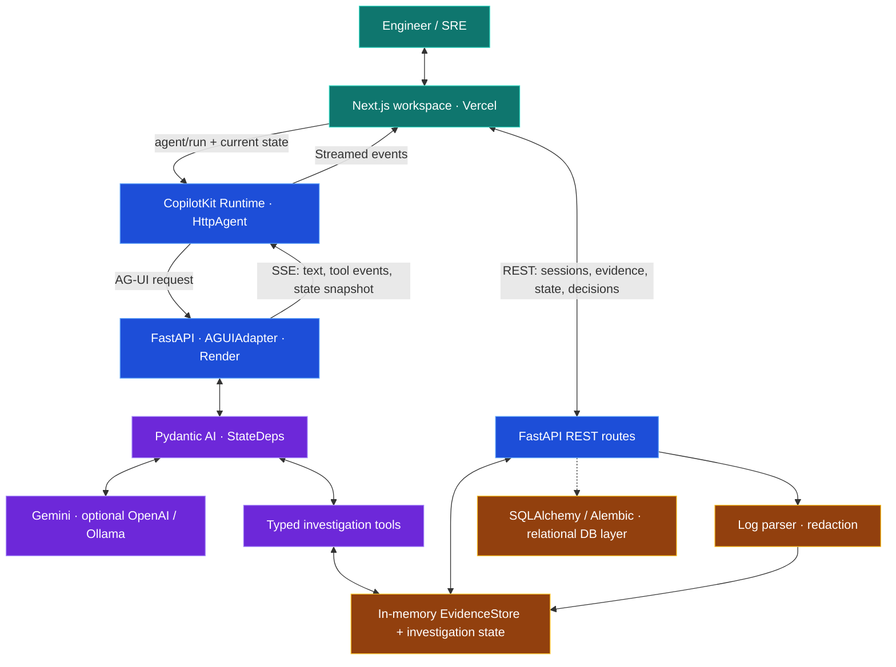
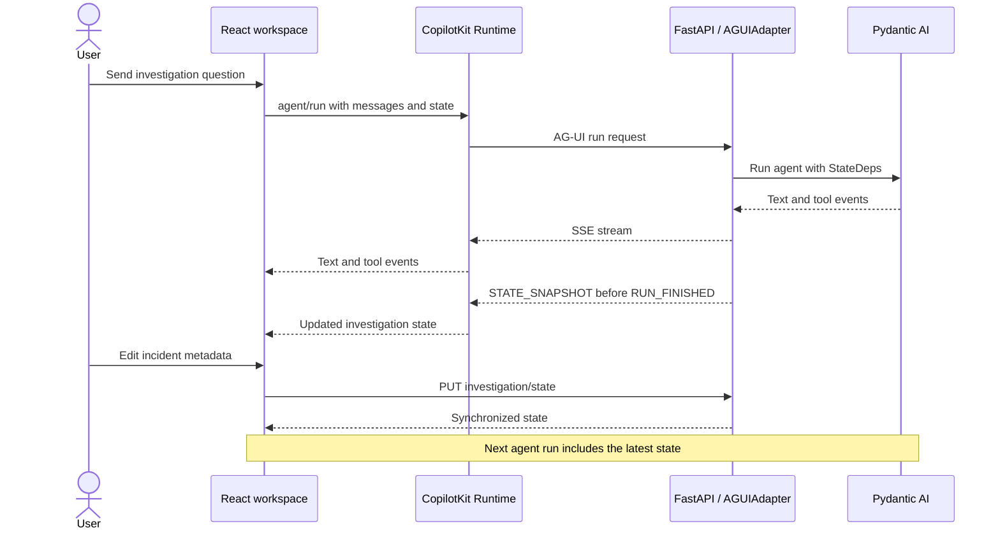

<div align="center">


# TraceAnvaya

### Agentic Incident Investigation & Replay Platform

**From scattered logs to a connected investigation.**


[](https://github.com/manikumarkundena/traceanvaya/actions/workflows/ci.yml)

[](https://traceanvaya.vercel.app)
[](https://traceanvaya.vercel.app/workspace)

**[Product tour](#product-tour) · [Architecture](#architecture--shared-state-flow) · [Local setup](#local-setup) · [Documentation](#documentation)**

</div>

- **Live App (Vercel)**: [https://traceanvaya.vercel.app](https://traceanvaya.vercel.app) ([Open Workspace](https://traceanvaya.vercel.app/workspace))
- **Live Backend API (Render)**: [https://traceanvaya.onrender.com](https://traceanvaya.onrender.com) ([Health Check](https://traceanvaya.onrender.com/api/health))

TraceAnvaya is a full-stack AI incident investigation workspace built with **Next.js 15**, **CopilotKit**, **AG-UI**, and **Pydantic AI**. It helps software engineers and SREs investigate software failures by correlating application logs, surfacing evidence-backed findings, replaying incident timelines, and reviewing remediation plans before approval.

<p align="center">
  
</p>

## Why TraceAnvaya?


When a failure spans multiple services, the evidence is often scattered across logs, timestamps and error messages. TraceAnvaya brings those pieces into one interactive workspace, where an agent can retrieve evidence, maintain investigation context and propose next steps while the engineer remains in control.

| Investigation challenge | TraceAnvaya approach |
| --- | --- |
| Scattered logs across services | Source-labelled evidence and trace correlation |
| Unstructured AI answers | Evidence citations, findings and hypotheses |
| Lost investigation context | Bidirectional shared state |
| Unclear sequence of failures | Chronological incident replay |
| Risky automated fixes | Human-reviewed, simulated remediation |
| Manual incident documentation | Exportable Markdown postmortem |

> **Design principle:** AI assists the investigation; the engineer owns the decision.

<div align="center">

| **8** | **3** | **26** |
| :---: | :---: | :---: |
| Registered agent tools | Synthetic incident scenarios | Backend tests reported passing at submission |

</div>

---

## How it works




**Try it in two minutes:** open the workspace, load Database Connection Pool Exhaustion, ask "What caused this incident? Cite the relevant evidence", inspect the citations and timeline, then review a proposed remediation and export a postmortem. On the hosted free tier, allow time for the backend to wake up.

## Product tour


### Core capabilities

- **Incident Investigator Chat**: Streams responses over AG-UI SSE with safe Markdown rendering, clickable `[ev-XXX]` citations, suggested prompts, and `.log` / `.txt` / `.json` log upload (up to 10 MB with automatic secret redaction).
- **Bidirectional Shared State (`Overview`)**: Editable incident title, severity, and affected service synchronized with the backend, alongside Findings, Root-cause hypotheses, Supporting evidence, and Remediation review.
- **Evidence Explorer**: Searchable, severity-filterable log viewer with raw payload inspection and correlated event navigation.
- **Incident Replay**: Chronological playback scrubber (`Play`, `Pause`, `Step Back`, `Step Forward`) to trace how failures unfolded across services.
- **Postmortem Studio**: Generates and exports structured Markdown postmortem reports covering summary, timeline, findings, hypotheses, remediation decisions, and follow-up actions.
- **Pre-loaded Synthetic Scenarios**:
  1. `scenario-1`: Database Connection Pool Exhaustion (`order-billing-service`)
  2. `scenario-2`: Payment Gateway Timeout & Cascade (`checkout-gateway`)
  3. `scenario-3`: Auth Token Refresh Storm (`auth-service`)

| Live Investigation & Tool Calling | Bidirectional State Sync & Remediation | Postmortem Studio |
| :---: | :---: | :---: |
|  |  |  |

### Workspace in action

<p align="center">
  
</p>

*The investigation workspace combines conversational analysis with structured evidence, hypotheses and operator decisions.*

| Evidence explorer | Incident replay |
| :---: | :---: |
|  |  |

| Remediation review | Postmortem studio |
| :---: | :---: |
|  |  |

---

## Architecture & Shared-State Flow


The architecture separates the presentation layer, agent transport, investigation logic and data handling. CopilotKit connects the React workspace to Pydantic AI through AG-UI; REST endpoints complement the stream for explicit user actions.



The live workspace uses in-memory session state; the relational database layer is not a durable store for all active investigations.

### CopilotKit, AG-UI & Pydantic AI Integration
1. **CopilotKit Runtime (`/api/copilotkit`)**: `frontend/src/app/api/copilotkit/route.ts` mounts `CopilotRuntime` with an `@ag-ui/client` `HttpAgent` pointing to the FastAPI `/agent` endpoint (`BACKEND_AGENT_URL` or `${NEXT_PUBLIC_API_URL}/agent`).
2. **UI → Agent State Sync**: When an operator edits the incident title, severity, or affected service in the Overview panel, the frontend persists the update via `PUT /api/investigation/state?session_id=...` and sends the latest `InvestigationState` in subsequent CopilotKit `agent/run` requests. `AGUIAdapter` injects this state into `StateDeps[InvestigationState]`, and `@investigation_agent.instructions` exposes user edits on the next agent turn.
3. **Agent → UI State Sync**: Agent tools can retrieve evidence and update `ctx.deps.state`. The backend wraps `AGUIAdapter.run_stream()` to persist state and emit an AG-UI `STATE_SNAPSHOT` event before `RUN_FINISHED`, updating the Overview panel in real time.

### Message and shared-state lifecycle



### Eight registered agent tools

| Tool | Responsibility |
| --- | --- |
| `search_logs` | Find relevant log evidence |
| `get_log_entry` | Inspect a specific evidence record |
| `summarize_log_patterns` | Summarize patterns across logs |
| `correlate_services` | Connect evidence across service sources |
| `update_investigation` | Update structured investigation information |
| `add_hypothesis` | Record a root-cause hypothesis |
| `propose_remediation` | Propose a plan for human review |
| `generate_postmortem` | Generate a structured incident summary |

### Codebase map

| Area | Source |
| --- | --- |
| Workspace orchestration | [workspace/page.tsx](frontend/src/app/workspace/page.tsx) |
| Chat and Markdown UI | [components/chat](frontend/src/components/chat) |
| Evidence, replay and review UI | [components/workspace](frontend/src/components/workspace) |
| CopilotKit bridge | [route.ts](frontend/src/app/api/copilotkit/route.ts) |
| API and SSE lifecycle | [routes.py](backend/app/api/routes.py) |
| Agent and tools | [incident_agent.py](backend/app/agents/incident_agent.py) |
| Provider selection | [provider_factory.py](backend/app/agents/provider_factory.py) |
| State schema | [incident.py](backend/app/schemas/incident.py) |
| Parsing and evidence storage | [services](backend/app/services) |
| Tests and automation | [backend/tests](backend/tests), [frontend/tests](frontend/tests), [CI](.github/workflows/ci.yml) |

---

## Technology Stack


| Layer | Technologies |
| :--- | :--- |
| **Frontend** | Next.js `15.1.7` (App Router), React `19.0.0`, TypeScript `5.7.3`, Tailwind CSS `3.4.17`, Motion `12.4.7` |
| **Typography** | Space Grotesk (display headings), Geist Sans (UI & body), Geist Mono (logs, timestamps, evidence IDs) |
| **Agent Protocol** | CopilotKit (`@copilotkit/react-core`, `@copilotkit/runtime` `1.90.2`), AG-UI (`@ag-ui/client` `1.0.5`, `ag-ui-protocol`) |
| **Backend** | FastAPI, Pydantic AI (`StateDeps[InvestigationState]`, `AGUIAdapter`), Google Gemini (`gemini-3.5-flash-lite`), Uvicorn |
| **Persistence** | SQLAlchemy (AsyncIO), Alembic migrations, SQLite (`aiosqlite` dev) / Neon PostgreSQL (`asyncpg` prod) |
| **Testing** | Pytest + `pytest-asyncio` (backend), Playwright (E2E, live AI, & responsive visual verification) |

---

## Local Setup


### Prerequisites
- **Node.js**: 20+ & npm
- **Python**: 3.12+
- **Git**

### 1. Environment Configuration
```bash
git clone https://github.com/manikumarkundena/traceanvaya.git
cd traceanvaya
cp .env.example .env
cp frontend/.env.example frontend/.env.local
```
Set `GEMINI_API_KEY` in `.env` for **Live AI Mode**, or leave it blank to run in **Demo Mode**.

### 2. Backend Setup & Migrations
```bash
cd backend
python -m venv .venv

# Windows
.\.venv\Scripts\activate
# macOS / Linux
source .venv/bin/activate

pip install -r requirements.txt
alembic upgrade head
python -m uvicorn app.main:app --reload --port 8000
```

### 3. Frontend Setup
In a separate terminal, from the repository root:
```bash
cd frontend
npm ci
npm run dev
```
Open [http://localhost:3000](http://localhost:3000) for the landing page, or [http://localhost:3000/workspace](http://localhost:3000/workspace) for the investigation workspace.

---

## Environment Variables


| Scope | Variable | Secret | Required | Format / Example |
| :--- | :--- | :---: | :---: | :--- |
| **Backend** | `ENVIRONMENT` | No | Yes | `development` or `production` |
| **Backend** | `SESSION_SECRET` | Yes | Prod | >= 32-char HMAC key (`generateValue: true` in `render.yaml`) |
| **Backend** | `DATABASE_URL` | Yes (prod) | Yes | `sqlite+aiosqlite:///./traceanvaya.db` or `postgresql://...` |
| **Backend** | `CORS_ORIGINS` | No | Yes | `http://localhost:3000` or `https://your-app.vercel.app` |
| **Backend** | `AI_PROVIDER` | No | Yes | `gemini` (or `openai`) |
| **Backend** | `AI_MODEL` | No | Yes | `gemini-3.5-flash-lite` |
| **Backend** | `GEMINI_API_KEY` | Yes | Optional | Google AI Studio key (omit for Demo Mode) |
| **Backend** | `RATE_LIMIT_PER_MINUTE` | No | No | `30` (per-IP `/agent` requests/min) |
| **Backend** | `SESSION_AI_LIMIT_PER_HOUR` | No | No | `40` (per-session hourly AI runs) |
| **Backend** | `MAX_CONCURRENT_AI_PER_SESSION` | No | No | `2` (concurrent AI runs per session) |
| **Backend** | `GLOBAL_AI_LIMIT_PER_HOUR` | No | No | `500` (global hourly AI safeguard) |
| **Backend** | `SESSION_TTL_SECONDS` | No | No | `86400` (24h in-memory session TTL) |
| **Backend** | `TRUST_PROXY_HEADERS` | No | No | `true` (trust `X-Forwarded-For` behind Render/Vercel) |
| **Backend** | `MAX_AGENT_BODY_BYTES` | No | No | `131072` (128 KB `/agent` body limit) |
| **Backend** | `MAX_RAW_EVIDENCE_BYTES` | No | No | `2097152` (2 MB `/api/evidence/raw` body limit) |
| **Backend** | `MAX_UPLOAD_BYTES` | No | No | `10485760` (10 MB `/api/evidence/upload` file limit) |
| **Frontend** | `NEXT_PUBLIC_API_URL` | No | Yes | `http://127.0.0.1:8000` or `https://traceanvaya.onrender.com` |
| **Frontend** | `BACKEND_AGENT_URL` | No | Yes | `http://127.0.0.1:8000/agent` or `https://traceanvaya.onrender.com/agent` |

Never expose `GEMINI_API_KEY`, `OPENAI_API_KEY`, or `DATABASE_URL` in `NEXT_PUBLIC_*` variables.

---

## Live AI, Optional Providers & Deterministic Demo Mode


TraceAnvaya supports three server-configured model providers and a deterministic demo mode (credentials and base URLs are never exposed to the browser):

1. **Google Gemini (Default Hosted Provider — Live-Verified)**:
   Set `AI_PROVIDER=gemini`, `AI_MODEL=gemini-3.5-flash-lite`, and `GEMINI_API_KEY` in `.env`. Live tool calling, AG-UI streaming, and bidirectional state sync have been verified end-to-end against Gemini.
2. **OpenAI (Optional — Not Live-Verified)**:
   Set `AI_PROVIDER=openai`, `OPENAI_API_KEY`, and a tool-capable `OPENAI_MODEL` (e.g. `gpt-4o-mini`). Implemented via Pydantic AI and covered by unit tests, but **not live-verified** against OpenAI's API.
3. **Local Ollama (Optional, Local-Only — Not Live-Verified)**:
   Install Ollama locally, pull a tool-capable model (`ollama pull llama3.1:8b`), start `ollama serve`, and set `AI_PROVIDER=ollama`, `OLLAMA_ENABLED=true`, `OLLAMA_BASE_URL=http://localhost:11434`, and `OLLAMA_MODEL=llama3.1:8b`. Implemented via Pydantic AI and covered by unit tests, but **not live-verified** against a live Ollama instance.
   - *Docker*: When the backend runs inside Docker and Ollama runs on the host, set `OLLAMA_BASE_URL=http://host.docker.internal:11434`.
   - *Remote Hosting*: A remotely hosted backend (Render) cannot access Ollama on a user's `localhost`.
4. **Deterministic Demo Mode**:
   When no LLM credentials are configured, the workspace displays **Demo Mode** and runs deterministic scenario analysis without external API calls. Failed live requests never fall back silently to fake responses.

---

## Investigating Your Own Logs


Click **New Investigation** in the workspace (or open `/workspace?new=1`) to create a genuinely empty custom investigation with zero preloaded demo logs:

- **Supported Formats**: `.log`, `.txt`, `.json`, `.jsonl` (up to `10 MB` upload / `2 MB` paste).
- **Multi-Service Labeling**: Tag each source (`Frontend`, `Backend`, `Database`, `API gateway`, `Authentication service`, `Infrastructure`, or a custom service name).
- **Correlation**: `LogParser` extracts ISO timestamps, severity, `trace_id`/`request_id`, and correlates anomalies across services without inventing missing timestamps.
- **Privacy & Redaction**: Before submitting, inspect the sanitized preview (`[REDACTED_JWT]`, `[REDACTED_API_KEY]`, `[REDACTED_PASSWORD]`, `[REDACTED_DB_PASS]`). Automatic redaction does not guarantee removal of every secret format.
- **Scope**: TraceAnvaya is an interactive incident investigation workspace—it is not an automatic website scanner, browser extension, or continuous monitoring agent.

---

## Engineering highlights


| Decision | Rationale |
| --- | --- |
| Typed Pydantic AI tools | Explicit tool inputs and structured investigation state |
| SSE with AG-UI events | Incremental text, tool activity and state synchronization |
| Hybrid REST + agent state | Explicit user edits and evidence operations alongside agent updates |
| Bounded Markdown parsing and batched rendering | Avoid unbounded parsing and excessive updates during streaming |
| Signed anonymous sessions | Isolate visitor investigations without requiring account creation |
| Provider abstraction | Separate model configuration from investigation logic |

## Testing & Verification


### Backend Tests (Pytest)
```bash
cd backend
.\.venv\Scripts\pytest -v
```
Covers log parsing, secret redaction, anonymous session isolation, body/upload size limits, rate/quota guards, Pydantic AI tools (`TestModel`), human-gated remediation workflow, database persistence, and AG-UI event validation (`26 passed`).

### Frontend Checks & Playwright E2E
```bash
cd frontend
npx tsc --noEmit
npm run lint
npm run build
npx playwright test tests/workspace.spec.ts tests/stage31-motion.spec.ts tests/security-and-polish.spec.ts --workers=1
```
To include the live Gemini + CopilotKit E2E test (requires `GEMINI_API_KEY` and running backend/frontend servers):
```bash
npx playwright test tests/live-ai.spec.ts
```

---

## Production Deployment


TraceAnvaya is pre-configured for **Vercel** (frontend), **Render** (backend via [render.yaml](render.yaml)), and **Neon** (managed PostgreSQL). See [docs/DEPLOYMENT.md](docs/DEPLOYMENT.md) for step-by-step instructions.

---

## Safety Boundaries & Known Limitations


- **Simulated Remediation Only**: Approving or rejecting a remediation plan records an operator decision in the audit trail (`APPROVED` / `REJECTED`) and never executes shell commands or modifies live infrastructure.
- **Hosting Cold Starts (Render Free Tier)**: The hosted backend on Render spins down after periods of inactivity; the first request after idle time may take 30–50+ seconds while the container wakes up.
- **Free-Tier AI Rate Limits**: Live Gemini inference depends on the configured API tier and may return transient `429` (`Quota / Rate Limit Exceeded`) or `503` responses under burst traffic.
- **Anonymous Session Isolation & Persistence Boundary**: Each visitor initializes an isolated session (`POST /api/sessions/init`) backed by an HMAC-SHA256 signed token (`traceanvaya_sid` `HttpOnly` cookie + `X-TraceAnvaya-Session` header). Production startup (`ENVIRONMENT=production`) requires `SESSION_SECRET` (>= 32 chars). PostgreSQL (Neon + Alembic `2b17c4fcd53d_initial_schema.py`) stores the relational schema, while active workspace sessions, `EvidenceStore`, AG-UI `StateDeps` snapshots, and rate/quota counters are stored in-memory (`24h` TTL) and reset on backend restarts or `SESSION_SECRET` rotation (the frontend recovers automatically by initializing a fresh session).
- **Single-Process Rate & Quota Guards**: `/api/agent` enforces per-IP RPM (`30`), per-session hourly (`40`) and concurrency (`2`) limits, a global hourly safeguard (`500`), and a `128 KB` streaming body limit; `/api/evidence/raw` enforces `2 MB` and `/api/evidence/upload` enforces `10 MB`. Multi-worker deployments should place shared rate limiting in Redis or an API gateway.

---

## Documentation


- [Deployment Guide](docs/DEPLOYMENT.md) — Vercel, Render, Neon PostgreSQL, and Docker Compose setup.
- [Developer Handover Guide](docs/DEVELOPER_GUIDE.md) — Folder structure, AG-UI data flow, and troubleshooting.
- [Architecture Blueprint](docs/ARCHITECTURE.md)
- [AG-UI Protocol Specification](docs/AGENT_PROTOCOL.md)
- [Design Decisions](docs/DESIGN_DECISIONS.md)

---

<div align="center">

**TraceAnvaya** · Evidence first. Human decisions always.

[Live application](https://traceanvaya.vercel.app) · [Workspace](https://traceanvaya.vercel.app/workspace) · [Source code](https://github.com/manikumarkundena/traceanvaya)


</div>
