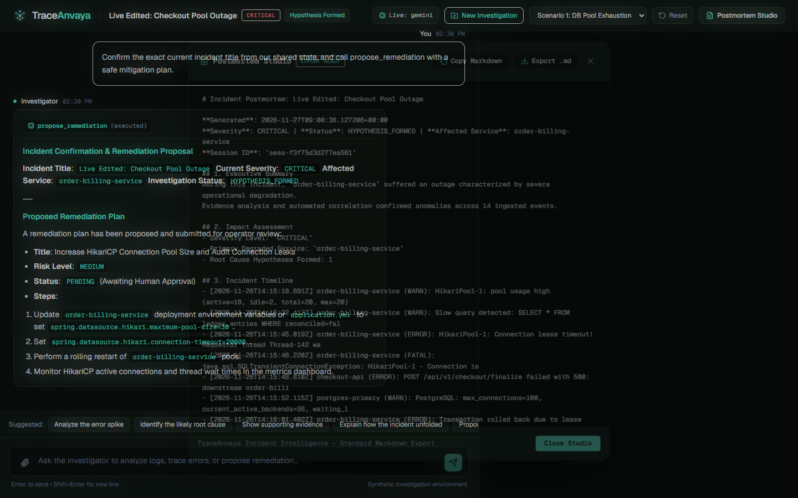

# TraceAnvaya

**Agentic Incident Investigation & Replay Platform**

TraceAnvaya is a full-stack AI incident investigation workspace built with **Next.js 15**, **CopilotKit**, **AG-UI**, and **Pydantic AI**. It helps software engineers and SREs investigate simulated software failures by correlating application logs, surfacing evidence-backed findings, replaying incident timelines, and reviewing remediation plans before approval.


---

## Core Capabilities

- **Incident Investigator Chat**: Streams responses over AG-UI SSE with safe Markdown rendering, clickable `[ev-XXX]` citations, suggested prompts, and `.log` / `.txt` / `.json` log upload (up to 10 MB with automatic secret redaction).
- **Bidirectional Shared State (`Overview`)**: Editable incident title, severity, and affected service synchronized with the backend, alongside Findings, Root-cause hypotheses, Supporting evidence, and Remediation review.
- **Evidence Explorer**: Searchable, severity-filterable log viewer with raw payload inspection and correlated event navigation.
- **Incident Replay**: Chronological playback scrubber (`Play`, `Pause`, `Step Back`, `Step Forward`) to trace how failures unfolded across services.
- **Postmortem Studio**: Generates and exports structured Markdown postmortem reports covering summary, timeline, findings, hypotheses, remediation decisions, and follow-up actions.
- **Pre-loaded Synthetic Scenarios**:
  1. `scenario-1`: Database Connection Pool Exhaustion (`order-billing-service`)
  2. `scenario-2`: Payment Gateway Timeout & Cascade (`checkout-gateway`)
  3. `scenario-3`: Auth Token Refresh Storm (`auth-service`)

| Live Investigation & Tool Calling | Bidirectional State Sync & Remediation | Postmortem Studio |
| :---: | :---: | :---: |
|  |  |  |

---

## Architecture & Shared-State Flow

```
┌────────────────────────────────────────────────────────────────────┐
│                    Next.js 15 Frontend (Vercel)                    │
│  - CopilotKit Runtime (/api/copilotkit -> HttpAgent)               │
│  - Workspace: Investigator Chat | Overview | Evidence | Timeline   │
└───────────────▲────────────────────────────────────▲───────────────┘
                │ AG-UI SSE Stream (/agent)          │ REST Sync
                │ TEXT_MESSAGE_CONTENT               │ PUT /api/investigation/state
                │ TOOL_CALL_START / TOOL_CALL_RESULT │ POST /api/evidence/upload
                │ STATE_SNAPSHOT                     │ GET /api/investigation/postmortem
┌───────────────▼────────────────────────────────────▼───────────────┐
│               FastAPI & Pydantic AI Backend (Render)               │
│  - AGUIAdapter(agent=investigation_agent, deps=StateDeps)          │
│  - Gemini 3.5 Flash-Lite (GoogleModel / GoogleProvider)            │
│  - LogParser (secret redaction for JWTs, API keys, passwords)      │
│  - EvidenceStore & Async SQLAlchemy / Alembic (Neon PostgreSQL)    │
└────────────────────────────────────────────────────────────────────┘
```

### CopilotKit, AG-UI & Pydantic AI Integration
1. **CopilotKit Runtime (`/api/copilotkit`)**: `frontend/src/app/api/copilotkit/route.ts` mounts `CopilotRuntime` with an `@ag-ui/client` `HttpAgent` pointing to the FastAPI `/agent` endpoint (`BACKEND_AGENT_URL` or `${NEXT_PUBLIC_API_URL}/agent`).
2. **UI → Agent State Sync**: When an operator edits the incident title, severity, or affected service in the Overview panel, the frontend persists the update via `PUT /api/investigation/state?session_id=...` and sends the latest `InvestigationState` in subsequent CopilotKit `agent/run` requests. `AGUIAdapter` injects this state into `StateDeps[InvestigationState]`, and `@investigation_agent.instructions` exposes user edits on the next agent turn.
3. **Agent → UI State Sync**: Agent tools (`search_logs`, `get_log_entry`, `summarize_log_patterns`, `update_investigation`, `add_hypothesis`, `propose_remediation`) mutate `ctx.deps.state`. The backend wraps `AGUIAdapter.run_stream()` to persist state and emit an AG-UI `STATE_SNAPSHOT` event before `RUN_FINISHED`, updating the Overview panel in real time.

---

## Technology Stack

| Layer | Technologies |
| :--- | :--- |
| **Frontend** | Next.js `15.1.7` (App Router), React `19.0.0`, TypeScript `5.7.3`, Tailwind CSS `3.4.17`, Motion `12.4.7` |
| **Typography** | Space Grotesk (display headings), Geist Sans (UI & body), Geist Mono (logs, timestamps, evidence IDs) |
| **Agent Protocol** | CopilotKit (`@copilotkit/react-core`, `@copilotkit/runtime` `1.90.2`), AG-UI (`@ag-ui/client` `1.0.5`, `ag-ui-protocol`) |
| **Backend** | FastAPI, Pydantic AI (`StateDeps[InvestigationState]`, `AGUIAdapter`), Google Gemini (`gemini-3.5-flash-lite`), Uvicorn |
| **Persistence** | SQLAlchemy (AsyncIO), Alembic migrations, SQLite (`aiosqlite` dev) / Neon PostgreSQL (`asyncpg` prod) |
| **Testing** | Pytest + `pytest-asyncio` (backend), Playwright (E2E, live AI, & responsive visual verification) |

---

## Local Setup

### Prerequisites
- **Node.js**: 20+ & npm
- **Python**: 3.12+
- **Git**

### 1. Environment Configuration
```bash
git clone <repository_url>
cd TraceAnvaya
cp .env.example .env
cp frontend/.env.example frontend/.env.local
```
Set `GEMINI_API_KEY` in `.env` for **Live AI Mode**, or leave it blank to run in **Demo Mode**.

### 2. Backend Setup & Migrations
```bash
cd backend
python -m venv .venv

# Windows
.\.venv\Scripts\activate
# macOS / Linux
source .venv/bin/activate

pip install -r requirements.txt
alembic upgrade head
python -m uvicorn app.main:app --reload --port 8000
```

### 3. Frontend Setup
```bash
cd frontend
npm install
npm run dev
```
Open [http://localhost:3000](http://localhost:3000) for the landing page, or [http://localhost:3000/workspace](http://localhost:3000/workspace) for the investigation workspace.

---

## Environment Variables

| Scope | Variable | Secret | Required | Format / Example |
| :--- | :--- | :---: | :---: | :--- |
| **Backend** | `ENVIRONMENT` | No | Yes | `development` or `production` |
| **Backend** | `SESSION_SECRET` | Yes | Prod | >= 32-char HMAC key (`generateValue: true` in `render.yaml`) |
| **Backend** | `DATABASE_URL` | Yes (prod) | Yes | `sqlite+aiosqlite:///./traceanvaya.db` or `postgresql://...` |
| **Backend** | `CORS_ORIGINS` | No | Yes | `http://localhost:3000` or `https://your-app.vercel.app` |
| **Backend** | `AI_PROVIDER` | No | Yes | `gemini` (or `openai`) |
| **Backend** | `AI_MODEL` | No | Yes | `gemini-3.5-flash-lite` |
| **Backend** | `GEMINI_API_KEY` | Yes | Optional | Google AI Studio key (omit for Demo Mode) |
| **Backend** | `RATE_LIMIT_PER_MINUTE` | No | No | `30` (per-IP `/agent` requests/min) |
| **Backend** | `SESSION_AI_LIMIT_PER_HOUR` | No | No | `40` (per-session hourly AI runs) |
| **Backend** | `MAX_CONCURRENT_AI_PER_SESSION` | No | No | `2` (concurrent AI runs per session) |
| **Backend** | `GLOBAL_AI_LIMIT_PER_HOUR` | No | No | `500` (global hourly AI safeguard) |
| **Backend** | `SESSION_TTL_SECONDS` | No | No | `86400` (24h in-memory session TTL) |
| **Backend** | `TRUST_PROXY_HEADERS` | No | No | `true` (trust `X-Forwarded-For` behind Render/Vercel) |
| **Backend** | `MAX_AGENT_BODY_BYTES` | No | No | `131072` (128 KB `/agent` body limit) |
| **Backend** | `MAX_RAW_EVIDENCE_BYTES` | No | No | `2097152` (2 MB `/api/evidence/raw` body limit) |
| **Backend** | `MAX_UPLOAD_BYTES` | No | No | `10485760` (10 MB `/api/evidence/upload` file limit) |
| **Frontend** | `NEXT_PUBLIC_API_URL` | No | Yes | `http://127.0.0.1:8000` or `https://traceanvaya-api.onrender.com` |
| **Frontend** | `BACKEND_AGENT_URL` | No | Yes | `http://127.0.0.1:8000/agent` or `https://traceanvaya-api.onrender.com/agent` |

Never expose `GEMINI_API_KEY`, `OPENAI_API_KEY`, or `DATABASE_URL` in `NEXT_PUBLIC_*` variables.

---

## Live AI, Local Ollama & Deterministic Demo Mode

TraceAnvaya supports three server-configured inference modes (credentials and base URLs are never exposed to the browser):

1. **Google Gemini (Default Hosted Provider)**:
   Set `AI_PROVIDER=gemini`, `AI_MODEL=gemini-3.5-flash-lite`, and `GEMINI_API_KEY` in `.env`.
2. **OpenAI (Optional)**:
   Set `AI_PROVIDER=openai`, `OPENAI_API_KEY`, and a tool-capable `OPENAI_MODEL` (e.g. `gpt-4o-mini`).
3. **Local Ollama (Optional, Local-Only)**:
   Install Ollama locally, pull a tool-capable model (`ollama pull llama3.1:8b`), start `ollama serve`, and set `AI_PROVIDER=ollama`, `OLLAMA_ENABLED=true`, `OLLAMA_BASE_URL=http://localhost:11434`, and `OLLAMA_MODEL=llama3.1:8b`.
   - *Docker*: When the backend runs inside Docker and Ollama runs on the host, set `OLLAMA_BASE_URL=http://host.docker.internal:11434`.
   - *Remote Hosting*: A remotely hosted backend (Render) cannot access Ollama on a user's `localhost`.
4. **Deterministic Demo Mode**:
   When no LLM credentials are configured, the workspace displays **Demo Mode** and runs deterministic scenario analysis without external API calls. Failed live requests never fall back silently to fake responses.

---

## Investigating Your Own Logs

Click **New Investigation** in the workspace (or open `/workspace?new=1`) to create a genuinely empty custom investigation with zero preloaded demo logs:

- **Supported Formats**: `.log`, `.txt`, `.json`, `.jsonl` (up to `10 MB` upload / `2 MB` paste).
- **Multi-Service Labeling**: Tag each source (`Frontend`, `Backend`, `Database`, `API gateway`, `Authentication service`, `Infrastructure`, or a custom service name).
- **Correlation**: `LogParser` extracts ISO timestamps, severity, `trace_id`/`request_id`, and correlates anomalies across services without inventing missing timestamps.
- **Privacy & Redaction**: Before submitting, inspect the sanitized preview (`[REDACTED_JWT]`, `[REDACTED_API_KEY]`, `[REDACTED_PASSWORD]`, `[REDACTED_DB_PASS]`). Automatic redaction does not guarantee removal of every secret format.
- **Scope**: TraceAnvaya is an interactive incident investigation workspace—it is not an automatic website scanner, browser extension, or continuous monitoring agent.

---

## Testing & Verification

### Backend Tests (Pytest)
```bash
cd backend
.\.venv\Scripts\pytest -v
```
Covers log parsing, secret redaction, anonymous session isolation, body/upload size limits, rate/quota guards, Pydantic AI tools (`TestModel`), human-gated remediation workflow, database persistence, and AG-UI event validation (`20 passed`).

### Frontend Checks & Playwright E2E
```bash
cd frontend
npx tsc --noEmit
npm run lint
npm run build
npx playwright test tests/workspace.spec.ts tests/stage31-motion.spec.ts tests/security-and-polish.spec.ts --workers=1
```
To include the live Gemini + CopilotKit E2E test (requires `GEMINI_API_KEY` and running backend/frontend servers):
```bash
npx playwright test tests/live-ai.spec.ts
```

---

## Production Deployment

TraceAnvaya is pre-configured for **Vercel** (frontend), **Render** (backend via [render.yaml](render.yaml)), and **Neon** (managed PostgreSQL). See [docs/DEPLOYMENT.md](docs/DEPLOYMENT.md) for step-by-step instructions.

---

## Safety Boundaries & Known Limitations

- **Simulated Remediation Only**: Approving a remediation plan records an operator decision in the audit trail (`APPROVED` / `REJECTED`) and never executes shell commands or modifies live infrastructure.
- **Anonymous Session Isolation**: Each visitor initializes an isolated session (`POST /api/sessions/init`) backed by an HMAC-SHA256 signed token (`traceanvaya_sid` `HttpOnly` cookie + `X-TraceAnvaya-Session` header). Production startup (`ENVIRONMENT=production`) requires `SESSION_SECRET` (>= 32 chars).
- **Persistence Boundary**: PostgreSQL (Neon + Alembic `2b17c4fcd53d_initial_schema.py`) stores the relational schema (`investigations`, `evidence_items`, `hypotheses`, `remediations`, `postmortem_reports`), while active workspace sessions, AG-UI `StateDeps` snapshots, and rate/quota counters are stored in-memory (`EvidenceStore`, `AIRateAndQuotaGuard`) with 24h TTL pruning.
- **Single-Process Rate & Quota Guards**: `/api/agent` enforces per-IP RPM (`30`), per-session hourly (`40`) and concurrency (`2`) limits, a global hourly safeguard (`500`), and a `128 KB` streaming body limit; `/api/evidence/raw` enforces `2 MB` and `/api/evidence/upload` enforces `10 MB`. Multi-worker deployments should place shared rate limiting in Redis or an API gateway.
- **Free-Tier LLM Quotas**: Public live inference depends on the configured Gemini API tier and may return transient `429` or `503` provider responses under high load.

---

## Documentation

- [Deployment Guide](docs/DEPLOYMENT.md) — Vercel, Render, Neon PostgreSQL, and Docker Compose setup.
- [Developer Handover Guide](docs/DEVELOPER_GUIDE.md) — Folder structure, AG-UI data flow, and troubleshooting.
- [Architecture Blueprint](docs/ARCHITECTURE.md)
- [AG-UI Protocol Specification](docs/AGENT_PROTOCOL.md)
- [Design Decisions](docs/DESIGN_DECISIONS.md)
